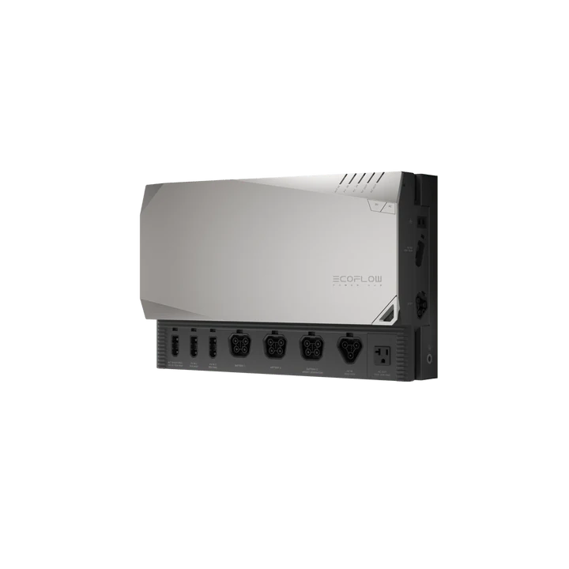

# EcoFlow Power Kits

**Category:** Smart Living · **Auto-detected by SN prefix:** `M10`

> Generated from `custom_components/ecoflow_iot/devices/smart_living/power_kits.py` by `scripts/gen_device_docs.py` — do not edit by hand.
> Every device also exposes an always-available **Connection** diagnostic sensor (MQTT state + data source).

Legend: 🔧 = diagnostic entity · 💤 = disabled by default · 🌐 = HTTP-only (refreshed on a slower HTTP cadence, not via MQTT) · ⚠️ = undocumented (reverse-engineered, may break).

## Sensors

| Entity | Device | Device class | Unit | Quota key | Flags |
|---|---|---|---|---|---|
| Total battery input power | main | power | W | `totalInWatts` |  |
| Total battery output power | main | power | W | `totalOutWatts` |  |
| Total battery current | main | current | A | `totalAmp` | 🔧 |
| System remaining time | main | duration | min | `totalRemainTime` | 🔧 |
| Total battery capacity | main | — | — | `totalFullCap` | 🔧 💤 |
| Generator start SOC lower limit | main | — | % | `oilStartDownline` | 🔧 💤 |
| Generator stop SOC upper limit | main | — | % | `oilStopUpline` | 🔧 💤 |
| BMS UPS charge upper limit | main | — | % | `bmsChgUpline` | 🔧 💤 |
| BMS UPS discharge lower limit | main | — | % | `bmsDsgDownline` | 🔧 💤 |
| State of charge | Battery pack | battery | % | `soc` |  |
| Battery total SOC | main | battery | % | `totalSoc` | 💤 |
| Voltage | Battery pack | voltage | V | `vol` | 🔧 |
| Current | Battery pack | current | A | `amp` | 🔧 |
| Temperature | Battery pack | temperature | °C | `temp` |  |
| Max cell temperature | Battery pack | temperature | °C | `maxCellTemp` | 🔧 💤 |
| Min cell temperature | Battery pack | temperature | °C | `minCellTemp` | 🔧 💤 |
| Max cell voltage | Battery pack | voltage | V | `maxCellVol` | 🔧 💤 |
| Min cell voltage | Battery pack | voltage | V | `minCellVol` | 🔧 💤 |
| Input power | Battery pack | power | W | `inWatts` |  |
| Output power | Battery pack | power | W | `outWatts` |  |
| Remaining time | Battery pack | duration | min | `remainTime` | 🔧 |
| Full capacity | Battery pack | energy_storage | — | `fullCap` | 🔧 💤 |
| Remaining capacity | Battery pack | — | — | `remainCap` | 🔧 💤 |
| Design capacity | Battery pack | — | — | `designCap` | 🔧 💤 |
| Charge upper limit | Battery pack | — | % | `chgSetSoc` | 🔧 |
| Discharge lower limit | Battery pack | — | % | `dsgSetSoc` | 🔧 |
| Power | Power Hub DC input | power | W | `dcInWatts` |  |
| Voltage | Power Hub DC input | voltage | V | `dcInVol` | 🔧 |
| Current | Power Hub DC input | current | A | `dcInCurr` | 🔧 |
| Battery power | Power Hub DC input | power | W | `batWatts` | 💤 |
| Battery voltage | Power Hub DC input | voltage | V | `batVol` | 🔧 💤 |
| Radiator 1 temperature | Power Hub DC input | temperature | °C | `hs1Temp` | 🔧 💤 |
| Radiator 2 temperature | Power Hub DC input | temperature | °C | `hs2Temp` | 🔧 💤 |
| Daily energy | Power Hub DC input | energy | Wh | `dayEnergy` | 💤 |
| Total energy | Power Hub DC input | energy | Wh | `dsgEnergy` | 💤 |
| Max charge current | Power Hub DC input | current | A | `chgMaxCurr` | 🔧 💤 |
| Power | Power Hub DC output | power | W | `ldOutWatts` |  |
| Voltage | Power Hub DC output | voltage | V | `ldOutVol` | 🔧 |
| Current | Power Hub DC output | current | A | `ldOutCurr` | 🔧 |
| Battery power | Power Hub DC output | power | W | `batWatts` | 💤 |
| Battery voltage | Power Hub DC output | voltage | V | `batVol` | 🔧 💤 |
| Radiator 1 temperature | Power Hub DC output | temperature | °C | `hs1Temp` | 🔧 💤 |
| Daily energy | Power Hub DC output | energy | Wh | `dayEnergy` | 💤 |
| Total energy | Power Hub DC output | energy | Wh | `dsgEnergy` | 💤 |
| Battery SOC | Inverter/charger | battery | % | `realSoc` | 💤 |
| Charging voltage | Inverter/charger | voltage | V | `chgBatVol` | 🔧 💤 |
| Bus voltage | Inverter/charger | voltage | V | `busVol` | 🔧 💤 |
| DC temperature | Inverter/charger | temperature | °C | `dcTemp` | 🔧 💤 |
| Fan level | Inverter/charger | — | — | `fanLevel` | 🔧 💤 |
| BMS chargeable current | Inverter/charger | current | A | `bmsChgCurr` | 🔧 💤 |
| Input power | Inverter/charger | power | W | `inWatts` |  |
| Output power | Inverter/charger | power | W | `outWatts` |  |
| Input voltage | Inverter/charger | voltage | V | `inVol` | 🔧 |
| Output voltage | Inverter/charger | voltage | V | `outVol` | 🔧 |
| Input current | Inverter/charger | current | A | `inCurr` | 🔧 💤 |
| Output current | Inverter/charger | current | A | `outCurr` | 🔧 💤 |
| Input frequency | Inverter/charger | frequency | Hz | `inFreq` | 🔧 💤 |
| Output frequency | Inverter/charger | frequency | Hz | `outFreq` | 🔧 💤 |
| AC temperature | Inverter/charger | temperature | °C | `acTemp` | 🔧 💤 |
| Daily input energy | Inverter/charger | energy | Wh | `inputWhInDay` | 💤 |
| Daily output energy | Inverter/charger | energy | Wh | `outputWhInDay` | 💤 |
| Max AC input current | Inverter/charger | current | A | `acMaxCurrSer` | 🔧 💤 |
| PV1 input power | Solar charge controller | power | W | `pv1InWatts` |  |
| PV2 input power | Solar charge controller | power | W | `pv2InWatts` |  |
| PV1 input voltage | Solar charge controller | voltage | V | `pv1InVol` | 🔧 |
| PV2 input voltage | Solar charge controller | voltage | V | `pv2InVol` | 🔧 |
| PV1 input current | Solar charge controller | current | A | `pv1InCurr` | 🔧 💤 |
| PV2 input current | Solar charge controller | current | A | `pv2InCurr` | 🔧 💤 |
| Battery power | Solar charge controller | power | W | `batWatts` | 💤 |
| Battery voltage | Solar charge controller | voltage | V | `batVol` | 🔧 💤 |
| Battery current | Solar charge controller | current | A | `batCurr` | 🔧 💤 |
| Total charged energy | Solar charge controller | energy | Wh | `chgEnergy` |  |
| Daily energy | Solar charge controller | energy | Wh | `dayEnergy` | 💤 |
| Radiator 1 temperature | Solar charge controller | temperature | °C | `hs1Temp` | 🔧 💤 |
| Radiator 2 temperature | Solar charge controller | temperature | °C | `hs2Temp` | 🔧 💤 |
| Total power | AC distribution panel | power | W | `acTotalWatts` |  |
| Input voltage | AC distribution panel | voltage | V | `acInVol` | 🔧 |
| PCB temperature 1 | AC distribution panel | temperature | °C | `acTemp1` | 🔧 💤 |
| PCB temperature 2 | AC distribution panel | temperature | °C | `acTemp2` | 🔧 💤 |
| Circuit 1 power | AC distribution panel | power | W | _computed_ |  |
| Circuit 1 current | AC distribution panel | current | A | _computed_ | 🔧 💤 |
| Circuit 2 power | AC distribution panel | power | W | _computed_ |  |
| Circuit 2 current | AC distribution panel | current | A | _computed_ | 🔧 💤 |
| Circuit 3 power | AC distribution panel | power | W | _computed_ |  |
| Circuit 3 current | AC distribution panel | current | A | _computed_ | 🔧 💤 |
| Circuit 4 power | AC distribution panel | power | W | _computed_ |  |
| Circuit 4 current | AC distribution panel | current | A | _computed_ | 🔧 💤 |
| Circuit 5 power | AC distribution panel | power | W | _computed_ |  |
| Circuit 5 current | AC distribution panel | current | A | _computed_ | 🔧 💤 |
| Circuit 6 power | AC distribution panel | power | W | _computed_ |  |
| Circuit 6 current | AC distribution panel | current | A | _computed_ | 🔧 💤 |
| Total power | DC distribution panel | power | W | `dcTotalWatts` |  |
| Input voltage | DC distribution panel | voltage | V | `dcInVol` | 🔧 |
| PCB temperature 1 | DC distribution panel | temperature | °C | `dcTemp1` | 🔧 💤 |
| PCB temperature 2 | DC distribution panel | temperature | °C | `dcTemp2` | 🔧 💤 |
| Circuit 1 power | DC distribution panel | power | W | _computed_ | 💤 |
| Circuit 1 current | DC distribution panel | current | A | _computed_ | 🔧 💤 |
| Circuit 2 power | DC distribution panel | power | W | _computed_ | 💤 |
| Circuit 2 current | DC distribution panel | current | A | _computed_ | 🔧 💤 |
| Circuit 3 power | DC distribution panel | power | W | _computed_ | 💤 |
| Circuit 3 current | DC distribution panel | current | A | _computed_ | 🔧 💤 |
| Circuit 4 power | DC distribution panel | power | W | _computed_ | 💤 |
| Circuit 4 current | DC distribution panel | current | A | _computed_ | 🔧 💤 |
| Circuit 5 power | DC distribution panel | power | W | _computed_ | 💤 |
| Circuit 5 current | DC distribution panel | current | A | _computed_ | 🔧 💤 |
| Circuit 6 power | DC distribution panel | power | W | _computed_ | 💤 |
| Circuit 6 current | DC distribution panel | current | A | _computed_ | 🔧 💤 |
| Circuit 7 power | DC distribution panel | power | W | _computed_ | 💤 |
| Circuit 7 current | DC distribution panel | current | A | _computed_ | 🔧 💤 |
| Circuit 8 power | DC distribution panel | power | W | _computed_ | 💤 |
| Circuit 8 current | DC distribution panel | current | A | _computed_ | 🔧 💤 |
| Circuit 9 power | DC distribution panel | power | W | _computed_ | 💤 |
| Circuit 9 current | DC distribution panel | current | A | _computed_ | 🔧 💤 |
| Circuit 10 power | DC distribution panel | power | W | _computed_ | 💤 |
| Circuit 10 current | DC distribution panel | current | A | _computed_ | 🔧 💤 |
| Circuit 11 power | DC distribution panel | power | W | _computed_ | 💤 |
| Circuit 11 current | DC distribution panel | current | A | _computed_ | 🔧 💤 |
| Circuit 12 power | DC distribution panel | power | W | _computed_ | 💤 |
| Circuit 12 current | DC distribution panel | current | A | _computed_ | 🔧 💤 |
| Solar energy | main | energy | Wh | _integrated_ |  |
| Battery charge energy | main | energy | Wh | _integrated_ |  |
| Battery discharge energy | main | energy | Wh | _integrated_ |  |

## Binary sensors

| Entity | Device | Device class | Quota key | Flags |
|---|---|---|---|---|
| Charging | Battery pack | battery_charging | `inWatts` |  |
| Connected | Power Hub DC input | connectivity | `dcInState` | 🔧 |
| Charging paused | Power Hub DC input | problem | `chgPause` | 🔧 |
| Low power mode | Inverter/charger | — | `lsplFlag` | 🔧 💤 |
| Enabled | Inverter/charger | power | `invSwSta` |  |
| PV1 input active | Solar charge controller | power | `pv1InputFlag` | 🔧 |
| PV2 input active | Solar charge controller | power | `pv2InputFlag` | 🔧 |
| PTC heating | Battery pack | heat | `ptcHeatingFlag` | 🔧 💤 |
| UPS mode | Battery pack | — | `upsFlag` | 🔧 💤 |
| BMS permanent fault | Battery pack | problem | `bmsFault` | 🔧 |

## Switches

| Entity | Device | Quota key | Flags |
|---|---|---|---|
| Enabled | Power Hub DC output | `dcOutSta` |  |
| AC output | Inverter/charger | `powerOn` |  |
| Grid power priority (passthrough) | Inverter/charger | `passByModeEn` |  |
| Pause charging | Power Hub DC input | `chgPause` |  |
| Heating (by discharging) | Battery pack | `ptcAllowFlag` |  |

## Numbers

| Entity | Device | Unit | Range | Quota key | Flags |
|---|---|---|---|---|---|
| Charge upper limit | Battery pack | % | 50–100 (step 1) | `chgSetSoc` |  |
| Discharge lower limit | Battery pack | % | 0–50 (step 1) | `dsgSetSoc` |  |
| Display standby time | main | s | 0–3600 (step 30) | `lcdStandbyMin` |  |
| Generator start SOC | main | % | 0–100 (step 1) | `oilStartDownline` |  |
| Generator stop SOC | main | % | 0–100 (step 1) | `oilStopUpline` |  |
| DC output voltage tag (0=12V 1=24V) | main | — | 0–1 (step 1) | `cfgVolTag` |  |
| AC input current limit | Inverter/charger | A | 1–23 (step 1) | `acMaxCurrSer` |  |

## Buttons

| Entity | Device | Flags |
|---|---|---|
| Refresh data | main | 🔧 |
| Clear charging errors | main |  |
| Turn off battery packs | main | 💤 |

---

_Entity totals: 147 — 122 sensor, 10 binary_sensor, 5 switch, 7 number, 0 select, 0 light, 3 button._
