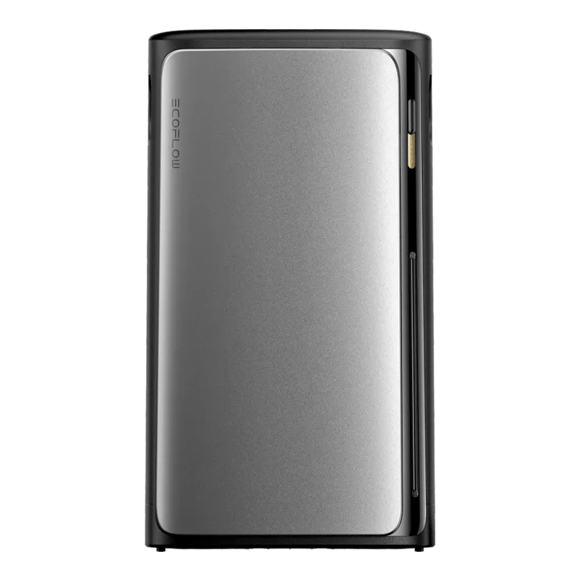

# EcoFlow STREAM 5000

**Category:** Solar Systems · **Auto-detected by SN prefix:** `ES21`, `ES22`

> Generated from `custom_components/ecoflow_iot/devices/solar_systems/stream_5000.py` by `scripts/gen_device_docs.py` — do not edit by hand.
> Every device also exposes an always-available **Connection** diagnostic sensor (MQTT state + data source).

Legend: 🔧 = diagnostic entity · 💤 = disabled by default · 🌐 = HTTP-only (refreshed on a slower HTTP cadence, not via MQTT) · ⚠️ = undocumented (reverse-engineered, may break).

## Sensors

| Entity | Device class | Unit | Quota key | Flags |
|---|---|---|---|---|
| Battery | battery | % | _computed_ |  |
| Solar power | power | W | _computed_ |  |
| Battery power | power | W | _computed_ |  |
| Load power | power | W | _computed_ |  |
| Grid power | power | W | _computed_ |  |
| Inverter power | power | W | _computed_ |  |
| Solar energy | energy | Wh | _integrated_ |  |
| Grid import energy | energy | Wh | _integrated_ |  |
| Grid export energy | energy | Wh | _integrated_ |  |
| Battery charge energy | energy | Wh | _integrated_ |  |
| Battery discharge energy | energy | Wh | _integrated_ |  |

## Switches

| Entity | Quota key | Flags |
|---|---|---|
| Backup reserve | _computed_ |  |
| Feed-in limit | _computed_ |  |
| AC socket | _computed_ |  |

## Numbers

| Entity | Unit | Range | Quota key | Flags |
|---|---|---|---|---|
| Backup reserve level | % | 0–100 (step 1) | _computed_ |  |

## Selects

| Entity | Options | Quota key | Flags |
|---|---|---|---|
| Operating mode | self_consumption, ai_mode, timer_task, pou_mode, emergency_stop | _derived_ |  |

---

_Entity totals: 16 — 11 sensor, 0 binary_sensor, 3 switch, 1 number, 1 select, 0 light._
