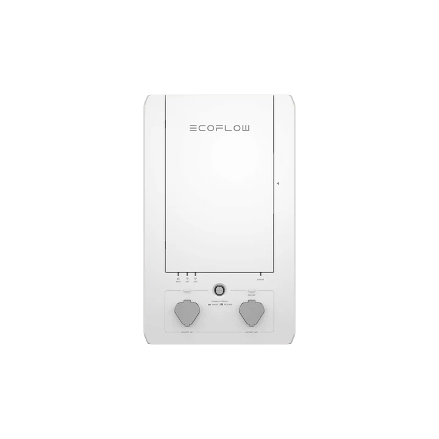

# EcoFlow Smart Home Panel

**Category:** Whole-Home Backup · **Auto-detected by SN prefix:** `SP10`

> Generated from `custom_components/ecoflow_iot/devices/whole_home_backup/smart_home_panel.py` by `scripts/gen_device_docs.py` — do not edit by hand.
> Every device also exposes an always-available **Connection** diagnostic sensor (MQTT state + data source).

Legend: 🔧 = diagnostic entity · 💤 = disabled by default · 🌐 = HTTP-only (refreshed on a slower HTTP cadence, not via MQTT) · ⚠️ = undocumented (reverse-engineered, may break).

> ⚠️ **Heads-up:** entities flagged ⚠️ are reverse-engineered from live device data and are **not part of EcoFlow's documented API**. They may change behaviour or stop working after a device firmware or EcoFlow app update.

## Sensors

| Entity | Device | Device class | Unit | Quota key | Flags |
|---|---|---|---|---|---|
| Backup battery | main | battery | % | `heartbeat.backupBatPer` |  |
| Backup full capacity | main | energy_storage | Wh | `heartbeat.backupFullCap` | 🔧 |
| Grid energy today | main | energy | Wh | `heartbeat.gridDayWatth` |  |
| Backup energy today | main | energy | Wh | `heartbeat.backupDayWatth` |  |
| Backup discharge time remaining | main | duration | min | `heartbeat.backupChaTime` | 🔧 |
| Device work time | main | duration | min | `heartbeat.workTime` | 🔧 💤 |
| Grid voltage | main | voltage | V | `gridInfo.gridVol` | 🔧 |
| Grid frequency | main | frequency | Hz | `gridInfo.gridFreq` | 🔧 |
| Charge upper threshold | main | battery | % | `backupChaDiscCfg.forceChargeHigh` | 🔧 |
| Discharge lower threshold | main | battery | % | `backupChaDiscCfg.discLower` | 🔧 |
| Power | Circuit 1 | power | W | _computed_ | ⚠️ |
| Name | Circuit 1 | — | — | _computed_ | 🔧 ⚠️ |
| Grid energy today | Circuit 1 | energy | Wh | _computed_ | ⚠️ |
| Battery energy today | Circuit 1 | energy | Wh | _computed_ | ⚠️ |
| Input voltage | Circuit 1 | voltage | V | _computed_ | 🔧 💤 ⚠️ |
| State | Circuit 1 | — | — | _computed_ |  |
| Configured current | Circuit 1 | current | A | _computed_ | 🔧 |
| Backup priority | Circuit 1 | — | — | _computed_ | 🔧 |
| Power | Circuit 2 | power | W | _computed_ | ⚠️ |
| Name | Circuit 2 | — | — | _computed_ | 🔧 ⚠️ |
| Grid energy today | Circuit 2 | energy | Wh | _computed_ | ⚠️ |
| Battery energy today | Circuit 2 | energy | Wh | _computed_ | ⚠️ |
| Input voltage | Circuit 2 | voltage | V | _computed_ | 🔧 💤 ⚠️ |
| State | Circuit 2 | — | — | _computed_ |  |
| Configured current | Circuit 2 | current | A | _computed_ | 🔧 |
| Backup priority | Circuit 2 | — | — | _computed_ | 🔧 |
| Power | Circuit 3 | power | W | _computed_ | ⚠️ |
| Name | Circuit 3 | — | — | _computed_ | 🔧 ⚠️ |
| Grid energy today | Circuit 3 | energy | Wh | _computed_ | ⚠️ |
| Battery energy today | Circuit 3 | energy | Wh | _computed_ | ⚠️ |
| Input voltage | Circuit 3 | voltage | V | _computed_ | 🔧 💤 ⚠️ |
| State | Circuit 3 | — | — | _computed_ |  |
| Configured current | Circuit 3 | current | A | _computed_ | 🔧 |
| Backup priority | Circuit 3 | — | — | _computed_ | 🔧 |
| Power | Circuit 4 | power | W | _computed_ | ⚠️ |
| Name | Circuit 4 | — | — | _computed_ | 🔧 ⚠️ |
| Grid energy today | Circuit 4 | energy | Wh | _computed_ | ⚠️ |
| Battery energy today | Circuit 4 | energy | Wh | _computed_ | ⚠️ |
| Input voltage | Circuit 4 | voltage | V | _computed_ | 🔧 💤 ⚠️ |
| State | Circuit 4 | — | — | _computed_ |  |
| Configured current | Circuit 4 | current | A | _computed_ | 🔧 |
| Backup priority | Circuit 4 | — | — | _computed_ | 🔧 |
| Power | Circuit 5 | power | W | _computed_ | ⚠️ |
| Name | Circuit 5 | — | — | _computed_ | 🔧 ⚠️ |
| Grid energy today | Circuit 5 | energy | Wh | _computed_ | ⚠️ |
| Battery energy today | Circuit 5 | energy | Wh | _computed_ | ⚠️ |
| Input voltage | Circuit 5 | voltage | V | _computed_ | 🔧 💤 ⚠️ |
| State | Circuit 5 | — | — | _computed_ |  |
| Configured current | Circuit 5 | current | A | _computed_ | 🔧 |
| Backup priority | Circuit 5 | — | — | _computed_ | 🔧 |
| Power | Circuit 6 | power | W | _computed_ | ⚠️ |
| Name | Circuit 6 | — | — | _computed_ | 🔧 ⚠️ |
| Grid energy today | Circuit 6 | energy | Wh | _computed_ | ⚠️ |
| Battery energy today | Circuit 6 | energy | Wh | _computed_ | ⚠️ |
| Input voltage | Circuit 6 | voltage | V | _computed_ | 🔧 💤 ⚠️ |
| State | Circuit 6 | — | — | _computed_ |  |
| Configured current | Circuit 6 | current | A | _computed_ | 🔧 |
| Backup priority | Circuit 6 | — | — | _computed_ | 🔧 |
| Power | Circuit 7 | power | W | _computed_ | ⚠️ |
| Name | Circuit 7 | — | — | _computed_ | 🔧 ⚠️ |
| Grid energy today | Circuit 7 | energy | Wh | _computed_ | ⚠️ |
| Battery energy today | Circuit 7 | energy | Wh | _computed_ | ⚠️ |
| Input voltage | Circuit 7 | voltage | V | _computed_ | 🔧 💤 ⚠️ |
| State | Circuit 7 | — | — | _computed_ |  |
| Configured current | Circuit 7 | current | A | _computed_ | 🔧 |
| Backup priority | Circuit 7 | — | — | _computed_ | 🔧 |
| Power | Circuit 8 | power | W | _computed_ | ⚠️ |
| Name | Circuit 8 | — | — | _computed_ | 🔧 ⚠️ |
| Grid energy today | Circuit 8 | energy | Wh | _computed_ | ⚠️ |
| Battery energy today | Circuit 8 | energy | Wh | _computed_ | ⚠️ |
| Input voltage | Circuit 8 | voltage | V | _computed_ | 🔧 💤 ⚠️ |
| State | Circuit 8 | — | — | _computed_ |  |
| Configured current | Circuit 8 | current | A | _computed_ | 🔧 |
| Backup priority | Circuit 8 | — | — | _computed_ | 🔧 |
| Power | Circuit 9 | power | W | _computed_ | ⚠️ |
| Name | Circuit 9 | — | — | _computed_ | 🔧 ⚠️ |
| Grid energy today | Circuit 9 | energy | Wh | _computed_ | ⚠️ |
| Battery energy today | Circuit 9 | energy | Wh | _computed_ | ⚠️ |
| Input voltage | Circuit 9 | voltage | V | _computed_ | 🔧 💤 ⚠️ |
| State | Circuit 9 | — | — | _computed_ |  |
| Configured current | Circuit 9 | current | A | _computed_ | 🔧 |
| Backup priority | Circuit 9 | — | — | _computed_ | 🔧 |
| Power | Circuit 10 | power | W | _computed_ | ⚠️ |
| Name | Circuit 10 | — | — | _computed_ | 🔧 ⚠️ |
| Grid energy today | Circuit 10 | energy | Wh | _computed_ | ⚠️ |
| Battery energy today | Circuit 10 | energy | Wh | _computed_ | ⚠️ |
| Input voltage | Circuit 10 | voltage | V | _computed_ | 🔧 💤 ⚠️ |
| State | Circuit 10 | — | — | _computed_ |  |
| Configured current | Circuit 10 | current | A | _computed_ | 🔧 |
| Backup priority | Circuit 10 | — | — | _computed_ | 🔧 |
| Power | Battery port 1 | power | W | _computed_ | 💤 ⚠️ |
| Battery | Battery port 1 | battery | % | _computed_ |  |
| Output power | Battery port 1 | power | W | _computed_ |  |
| Temperature | Battery port 1 | temperature | °C | _computed_ | 🔧 |
| Charge time remaining | Battery port 1 | duration | min | _computed_ | 🔧 💤 |
| Discharge time remaining | Battery port 1 | duration | min | _computed_ | 🔧 💤 |
| Full capacity | Battery port 1 | energy_storage | Wh | _computed_ | 🔧 💤 |
| Charge energy today | Battery port 1 | energy | Wh | _computed_ | ⚠️ |
| Power | Battery port 2 | power | W | _computed_ | 💤 ⚠️ |
| Battery | Battery port 2 | battery | % | _computed_ |  |
| Output power | Battery port 2 | power | W | _computed_ |  |
| Temperature | Battery port 2 | temperature | °C | _computed_ | 🔧 |
| Charge time remaining | Battery port 2 | duration | min | _computed_ | 🔧 💤 |
| Discharge time remaining | Battery port 2 | duration | min | _computed_ | 🔧 💤 |
| Full capacity | Battery port 2 | energy_storage | Wh | _computed_ | 🔧 💤 |
| Charge energy today | Battery port 2 | energy | Wh | _computed_ | ⚠️ |

## Binary sensors

| Entity | Device | Device class | Quota key | Flags |
|---|---|---|---|---|
| Grid status | main | power | `heartbeat.gridSta` |  |
| EPS mode | main | running | `epsModeInfo.eps` |  |
| On | Circuit 1 | power | _computed_ |  |
| Grid source | Circuit 1 | plug | _computed_ | 💤 |
| Emergency enabled | Circuit 1 | — | _computed_ | 💤 |
| Configured | Circuit 1 | — | _computed_ | 🔧 💤 ⚠️ |
| Split phase linked | Circuit 1 | — | _computed_ | 🔧 💤 ⚠️ |
| On | Circuit 2 | power | _computed_ |  |
| Grid source | Circuit 2 | plug | _computed_ | 💤 |
| Emergency enabled | Circuit 2 | — | _computed_ | 💤 |
| Configured | Circuit 2 | — | _computed_ | 🔧 💤 ⚠️ |
| Split phase linked | Circuit 2 | — | _computed_ | 🔧 💤 ⚠️ |
| On | Circuit 3 | power | _computed_ |  |
| Grid source | Circuit 3 | plug | _computed_ | 💤 |
| Emergency enabled | Circuit 3 | — | _computed_ | 💤 |
| Configured | Circuit 3 | — | _computed_ | 🔧 💤 ⚠️ |
| Split phase linked | Circuit 3 | — | _computed_ | 🔧 💤 ⚠️ |
| On | Circuit 4 | power | _computed_ |  |
| Grid source | Circuit 4 | plug | _computed_ | 💤 |
| Emergency enabled | Circuit 4 | — | _computed_ | 💤 |
| Configured | Circuit 4 | — | _computed_ | 🔧 💤 ⚠️ |
| Split phase linked | Circuit 4 | — | _computed_ | 🔧 💤 ⚠️ |
| On | Circuit 5 | power | _computed_ |  |
| Grid source | Circuit 5 | plug | _computed_ | 💤 |
| Emergency enabled | Circuit 5 | — | _computed_ | 💤 |
| Configured | Circuit 5 | — | _computed_ | 🔧 💤 ⚠️ |
| Split phase linked | Circuit 5 | — | _computed_ | 🔧 💤 ⚠️ |
| On | Circuit 6 | power | _computed_ |  |
| Grid source | Circuit 6 | plug | _computed_ | 💤 |
| Emergency enabled | Circuit 6 | — | _computed_ | 💤 |
| Configured | Circuit 6 | — | _computed_ | 🔧 💤 ⚠️ |
| Split phase linked | Circuit 6 | — | _computed_ | 🔧 💤 ⚠️ |
| On | Circuit 7 | power | _computed_ |  |
| Grid source | Circuit 7 | plug | _computed_ | 💤 |
| Emergency enabled | Circuit 7 | — | _computed_ | 💤 |
| Configured | Circuit 7 | — | _computed_ | 🔧 💤 ⚠️ |
| Split phase linked | Circuit 7 | — | _computed_ | 🔧 💤 ⚠️ |
| On | Circuit 8 | power | _computed_ |  |
| Grid source | Circuit 8 | plug | _computed_ | 💤 |
| Emergency enabled | Circuit 8 | — | _computed_ | 💤 |
| Configured | Circuit 8 | — | _computed_ | 🔧 💤 ⚠️ |
| Split phase linked | Circuit 8 | — | _computed_ | 🔧 💤 ⚠️ |
| On | Circuit 9 | power | _computed_ |  |
| Grid source | Circuit 9 | plug | _computed_ | 💤 |
| Emergency enabled | Circuit 9 | — | _computed_ | 💤 |
| Configured | Circuit 9 | — | _computed_ | 🔧 💤 ⚠️ |
| Split phase linked | Circuit 9 | — | _computed_ | 🔧 💤 ⚠️ |
| On | Circuit 10 | power | _computed_ |  |
| Grid source | Circuit 10 | plug | _computed_ | 💤 |
| Emergency enabled | Circuit 10 | — | _computed_ | 💤 |
| Configured | Circuit 10 | — | _computed_ | 🔧 💤 ⚠️ |
| Split phase linked | Circuit 10 | — | _computed_ | 🔧 💤 ⚠️ |
| Connected | Battery port 1 | connectivity | _computed_ | 🔧 |
| Grid charging | Battery port 1 | battery_charging | _computed_ | 💤 |
| Output | Battery port 1 | power | _computed_ | 💤 |
| Connected | Battery port 2 | connectivity | _computed_ | 🔧 |
| Grid charging | Battery port 2 | battery_charging | _computed_ | 💤 |
| Output | Battery port 2 | power | _computed_ | 💤 |

## Switches

| Entity | Device | Quota key | Flags |
|---|---|---|---|
| EPS mode | main | `epsModeInfo.eps` |  |
| ch1_load_switch | Circuit 1 | _computed_ |  |
| ch2_load_switch | Circuit 2 | _computed_ |  |
| ch3_load_switch | Circuit 3 | _computed_ |  |
| ch4_load_switch | Circuit 4 | _computed_ |  |
| ch5_load_switch | Circuit 5 | _computed_ |  |
| ch6_load_switch | Circuit 6 | _computed_ |  |
| ch7_load_switch | Circuit 7 | _computed_ |  |
| ch8_load_switch | Circuit 8 | _computed_ |  |
| ch9_load_switch | Circuit 9 | _computed_ |  |
| ch10_load_switch | Circuit 10 | _computed_ |  |
| Emergency enable | Circuit 1 | _computed_ | 💤 |
| Emergency enable | Circuit 2 | _computed_ | 💤 |
| Emergency enable | Circuit 3 | _computed_ | 💤 |
| Emergency enable | Circuit 4 | _computed_ | 💤 |
| Emergency enable | Circuit 5 | _computed_ | 💤 |
| Emergency enable | Circuit 6 | _computed_ | 💤 |
| Emergency enable | Circuit 7 | _computed_ | 💤 |
| Emergency enable | Circuit 8 | _computed_ | 💤 |
| Emergency enable | Circuit 9 | _computed_ | 💤 |
| Emergency enable | Circuit 10 | _computed_ | 💤 |

## Numbers

| Entity | Device | Unit | Range | Quota key | Flags |
|---|---|---|---|---|---|
| Charge upper threshold | main | % | 0–100 (step 1) | `backupChaDiscCfg.forceChargeHigh` |  |
| Discharge lower threshold | main | % | 0–100 (step 1) | `backupChaDiscCfg.discLower` |  |

---

_Entity totals: 187 — 106 sensor, 58 binary_sensor, 21 switch, 2 number, 0 select, 0 light, 0 button._
