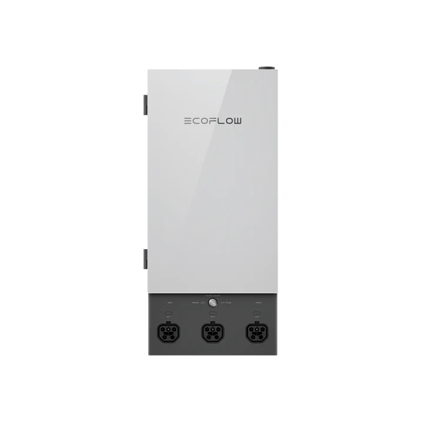

# EcoFlow Smart Home Panel 2

**Category:** Whole-Home Backup · **Auto-detected by SN prefix:** `HD3`

> Generated from `custom_components/ecoflow_iot/devices/whole_home_backup/smart_home_panel_ii.py` by `scripts/gen_device_docs.py` — do not edit by hand.
> Every device also exposes an always-available **Connection** diagnostic sensor (MQTT state + data source).

Legend: 🔧 = diagnostic entity · 💤 = disabled by default · 🌐 = HTTP-only (refreshed on a slower HTTP cadence, not via MQTT) · ⚠️ = undocumented (reverse-engineered, may break).

## Sensors

| Entity | Device | Device class | Unit | Quota key | Flags |
|---|---|---|---|---|---|
| Grid power | main | power | W | `wattInfo.gridWatt` |  |
| Home power | main | power | W | `wattInfo.allHallWatt` |  |
| Backup battery | main | battery | % | `backupIncreInfo.backupBatPer` |  |
| Backup time remaining | main | duration | min | `backupInfo.backupDischargeTime` | 🔧 |
| Backup charge time remaining | main | duration | min | `backupInfo.backupChargeTime` | 🔧 |
| Home max current | main | current | A | `masterCur` | 🔧 |
| Generator max output | main | power | W | `oilMaxOutputWatt` | 🔧 |
| Charging power | main | power | W | `chargeWattPower` | 🔧 |
| Charging limit | main | battery | % | `foceChargeHight` | 🔧 |
| Backup reserve | main | battery | % | `backupReserveSoc` | 🔧 |
| Power | Energy storage 1 | power | W | _computed_ |  |
| Battery | Energy storage 1 | battery | % | `backupIncreInfo.Energy1Info.batteryPercentage` |  |
| Power | Energy storage 2 | power | W | _computed_ |  |
| Battery | Energy storage 2 | battery | % | `backupIncreInfo.Energy2Info.batteryPercentage` |  |
| Power | Energy storage 3 | power | W | _computed_ |  |
| Battery | Energy storage 3 | battery | % | `backupIncreInfo.Energy3Info.batteryPercentage` |  |
| Power | Circuit 1 | power | W | _computed_ |  |
| Max current | Circuit 1 | current | A | `loadIncreInfo.hall1IncreInfo.ch1Info.setAmp` | 🔧 💤 |
| Power | Circuit 2 | power | W | _computed_ |  |
| Max current | Circuit 2 | current | A | `loadIncreInfo.hall1IncreInfo.ch2Info.setAmp` | 🔧 💤 |
| Power | Circuit 3 | power | W | _computed_ |  |
| Max current | Circuit 3 | current | A | `loadIncreInfo.hall1IncreInfo.ch3Info.setAmp` | 🔧 💤 |
| Power | Circuit 4 | power | W | _computed_ |  |
| Max current | Circuit 4 | current | A | `loadIncreInfo.hall1IncreInfo.ch4Info.setAmp` | 🔧 💤 |
| Power | Circuit 5 | power | W | _computed_ |  |
| Max current | Circuit 5 | current | A | `loadIncreInfo.hall1IncreInfo.ch5Info.setAmp` | 🔧 💤 |
| Power | Circuit 6 | power | W | _computed_ |  |
| Max current | Circuit 6 | current | A | `loadIncreInfo.hall1IncreInfo.ch6Info.setAmp` | 🔧 💤 |
| Power | Circuit 7 | power | W | _computed_ |  |
| Max current | Circuit 7 | current | A | `loadIncreInfo.hall1IncreInfo.ch7Info.setAmp` | 🔧 💤 |
| Power | Circuit 8 | power | W | _computed_ |  |
| Max current | Circuit 8 | current | A | `loadIncreInfo.hall1IncreInfo.ch8Info.setAmp` | 🔧 💤 |
| Power | Circuit 9 | power | W | _computed_ |  |
| Max current | Circuit 9 | current | A | `loadIncreInfo.hall1IncreInfo.ch9Info.setAmp` | 🔧 💤 |
| Power | Circuit 10 | power | W | _computed_ |  |
| Max current | Circuit 10 | current | A | `loadIncreInfo.hall1IncreInfo.ch10Info.setAmp` | 🔧 💤 |
| Power | Circuit 11 | power | W | _computed_ |  |
| Max current | Circuit 11 | current | A | `loadIncreInfo.hall1IncreInfo.ch11Info.setAmp` | 🔧 💤 |
| Power | Circuit 12 | power | W | _computed_ |  |
| Max current | Circuit 12 | current | A | `loadIncreInfo.hall1IncreInfo.ch12Info.setAmp` | 🔧 💤 |
| Grid import energy | main | energy | Wh | _integrated_ |  |
| Grid export energy | main | energy | Wh | _integrated_ |  |
| Home energy | main | energy | Wh | _integrated_ |  |

## Binary sensors

| Entity | Device | Device class | Quota key | Flags |
|---|---|---|---|---|
| Battery charging | main | battery_charging | `chargeWattPower` |  |
| Storm warning | main | safety | `stormIsEnable` |  |
| EPS mode | main | power | `epsModeInfo` | 🔧 |

## Switches

| Entity | Device | Quota key | Flags |
|---|---|---|---|
| Storm warning | main | `stormIsEnable` |  |
| EPS mode | main | `epsModeInfo` |  |
| Enabled | Energy storage 1 | `ch1EnableSet` |  |
| Enabled | Energy storage 2 | `ch2EnableSet` |  |
| Enabled | Energy storage 3 | `ch3EnableSet` |  |
| Force charge | Energy storage 1 | `ch1ForceCharge` |  |
| Force charge | Energy storage 2 | `ch2ForceCharge` |  |
| Force charge | Energy storage 3 | `ch3ForceCharge` |  |

## Numbers

| Entity | Device | Unit | Range | Quota key | Flags |
|---|---|---|---|---|---|
| Backup reserve level | main | % | 0–100 (step 1) | `backupReserveSoc` |  |
| Charging power | main | W | 500–7200 (step 100) | `chargeWattPower` |  |
| Charging limit | main | % | 80–100 (step 1) | `foceChargeHight` |  |
| Generator max output | main | W | 3000–12000 (step 1000) | `oilMaxOutputWatt` |  |
| Home max current | main | A | 6–10 (step 0.1) | `masterCur` |  |
| Max current | Circuit 1 | A | 10–60 (step 5) | `loadIncreInfo.hall1IncreInfo.ch1Info.setAmp` | 💤 |
| Max current | Circuit 2 | A | 10–60 (step 5) | `loadIncreInfo.hall1IncreInfo.ch2Info.setAmp` | 💤 |
| Max current | Circuit 3 | A | 10–60 (step 5) | `loadIncreInfo.hall1IncreInfo.ch3Info.setAmp` | 💤 |
| Max current | Circuit 4 | A | 10–60 (step 5) | `loadIncreInfo.hall1IncreInfo.ch4Info.setAmp` | 💤 |
| Max current | Circuit 5 | A | 10–60 (step 5) | `loadIncreInfo.hall1IncreInfo.ch5Info.setAmp` | 💤 |
| Max current | Circuit 6 | A | 10–60 (step 5) | `loadIncreInfo.hall1IncreInfo.ch6Info.setAmp` | 💤 |
| Max current | Circuit 7 | A | 10–60 (step 5) | `loadIncreInfo.hall1IncreInfo.ch7Info.setAmp` | 💤 |
| Max current | Circuit 8 | A | 10–60 (step 5) | `loadIncreInfo.hall1IncreInfo.ch8Info.setAmp` | 💤 |
| Max current | Circuit 9 | A | 10–60 (step 5) | `loadIncreInfo.hall1IncreInfo.ch9Info.setAmp` | 💤 |
| Max current | Circuit 10 | A | 10–60 (step 5) | `loadIncreInfo.hall1IncreInfo.ch10Info.setAmp` | 💤 |
| Max current | Circuit 11 | A | 10–60 (step 5) | `loadIncreInfo.hall1IncreInfo.ch11Info.setAmp` | 💤 |
| Max current | Circuit 12 | A | 10–60 (step 5) | `loadIncreInfo.hall1IncreInfo.ch12Info.setAmp` | 💤 |

## Selects

| Entity | Device | Options | Quota key | Flags |
|---|---|---|---|---|
| smart_backup_mode | main | disabled, tou, self_service, timed | _derived_ |  |

---

_Entity totals: 72 — 43 sensor, 3 binary_sensor, 8 switch, 17 number, 1 select, 0 light, 0 button._
